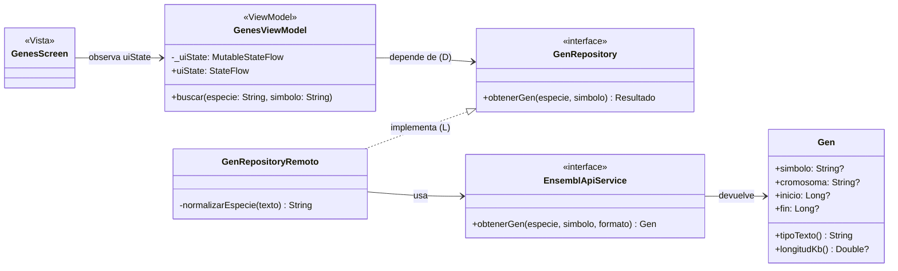

# Diseño de clases — Capa por capa

Este documento detalla la arquitectura y el diseño de clases de la aplicación **API-Practica**, siguiendo el patrón arquitectónico **MVVM (Model-View-ViewModel)** y los principios **SOLID**. Usamos el módulo de **Genes (Ensembl)** como ejemplo representativo.

## Diagrama de clases

---

## Descripción de capas

### 1. Capa de Vista (`ui/genes/GenesScreen.kt`)
- **Responsabilidad**: Interfaz de usuario declarativa construida con **Jetpack Compose**.
- **Comportamiento**:
  - Observa el `uiState` emitido por el `GenesViewModel` mediante `collectAsState()`.
  - Dibuja la pantalla según el estado actual (`cargando`, `error`, o con datos del `Gen`).
  - Captura las interacciones del usuario (como escribir la especie/símbolo y hacer clic en "Buscar gen") y delega los eventos llamando a los métodos del ViewModel.
  - Es completamente pasiva ("tonta"): no contiene lógica de negocio ni realiza llamadas de red directas.

### 2. Capa de ViewModel (`ui/genes/GenesViewModel.kt`)
- **Responsabilidad**: Gestionar el estado de la UI y la lógica de presentación.
- **Comportamiento**:
  - Mantiene un `MutableStateFlow<GenesUiState>` privado y expone un `StateFlow` de solo lectura.
  - Sobrevive a cambios de configuración (como la rotación de pantalla).
  - Recibe los eventos de la vista (`buscar()`), lanza corrutinas con `viewModelScope`, interactúa con el repositorio y actualiza el estado de forma reactiva (`_uiState.update { ... }`).
  - No conoce los detalles de Retrofit ni de Android UI (`Composable`).

### 3. Capa de Repositorios / Interfaz (`data/GenRepository.kt`)
- **Responsabilidad**: Abstracción de la fuente de datos (principio de inversión de dependencias - D de SOLID).
- **Comportamiento**:
  - Define el contrato `GenRepository` con el método `obtenerGen(especie, simbolo)`.
  - `GenRepositoryRemoto` (ubicado en el mismo archivo) implementa dicha interfaz, encargándose de invocar al servicio de red (`EnsemblApiService`) y manejar resultados (`Resultado.Exito` o `Resultado.Error`).

### 4. Capa de Red / API Service (`data/remote/EnsemblApiService.kt`)
- **Responsabilidad**: Definición de endpoints HTTP utilizando **Retrofit**.
- **Comportamiento**:
  - Interfaz con anotaciones HTTP (`@GET`) para comunicarse con la API REST de Ensembl.
  - Devuelve directamente el objeto modelo o respuestas suspendidas.

### 5. Capa de Modelo (`model/Gen.kt`)
- **Responsabilidad**: Representación de los datos y lógica de dominio/presentación de los datos.
- **Comportamiento**:
  - `data class` mapeada con anotaciones de **Gson** (`@SerializedName`).
  - Contiene métodos de encapsulamiento (`tipoTexto()`, `longitudKb()`, `inicioTexto()`, etc.) para formatear los datos brutos de la API antes de ser mostrados en la interfaz.

---

## Principios aplicados

- **Separation of Concerns (SoC)**: Cada clase tiene una única responsabilidad bien definida (UI, Estado, Datos, Red).
- **MVVM**: Desacopla la interfaz de usuario de la lógica de negocio y de los datos.
- **Inversión de Dependencias (D de SOLID)**: El `ViewModel` depende de la interfaz `GenRepository` y no de la implementación concreta `GenRepositoryRemoto`, facilitando la escalabilidad y las pruebas unitarias.
